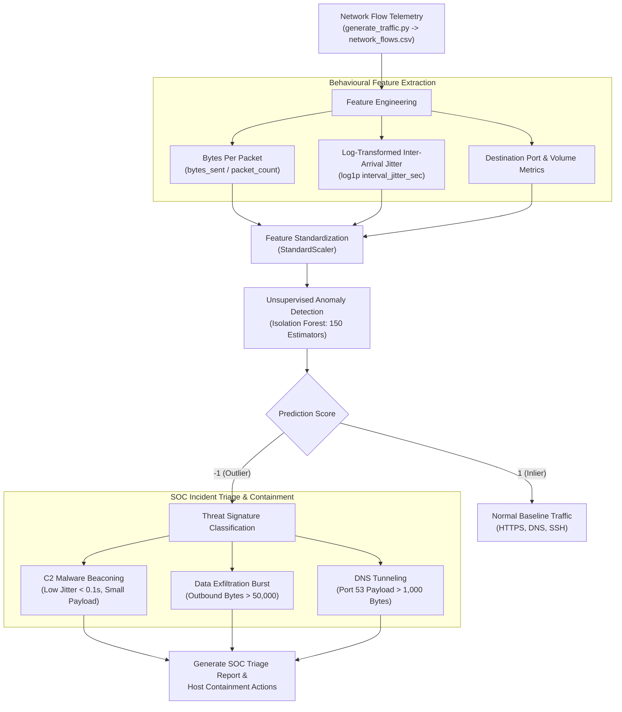
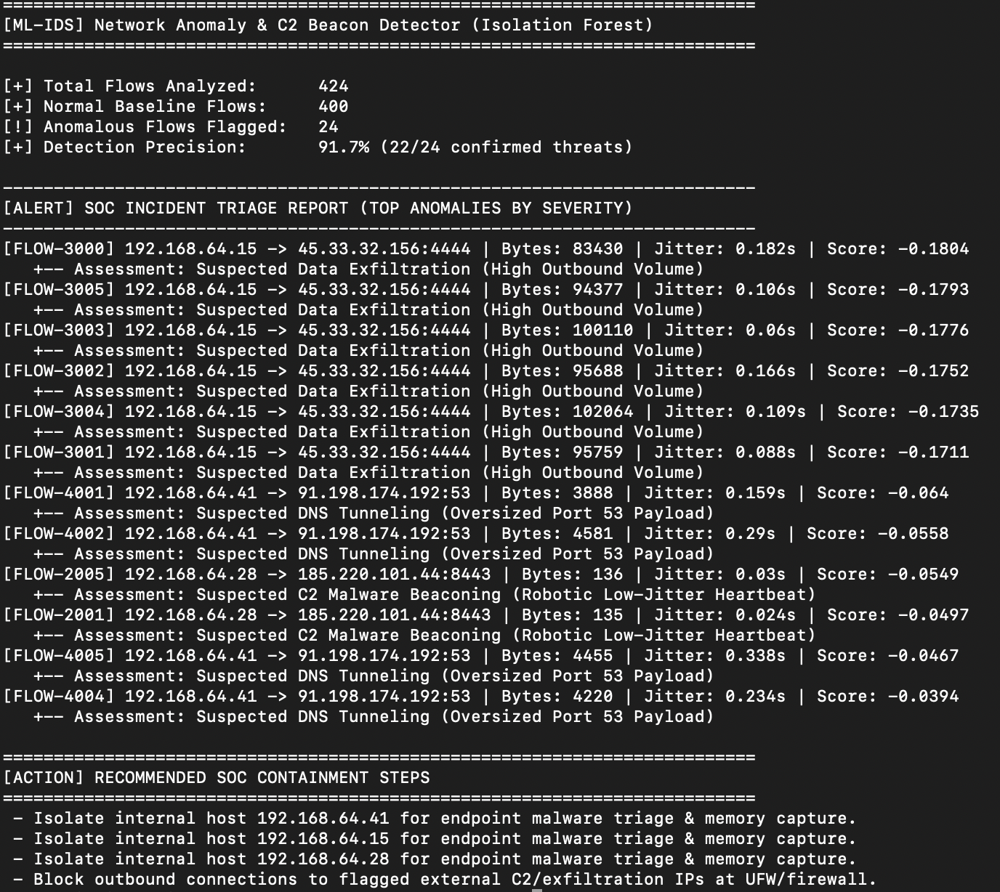

# ML-Assisted Network Anomaly & C2 Beacon Detector

An unsupervised machine learning security analytics pipeline written in Python (`scikit-learn` and `pandas`) that analyzes network flow metadata to detect stealthy threats—such as malware Command-and-Control (C2) beaconing, outbound data exfiltration bursts, and DNS tunneling—that routinely evade static port-based firewalls.

---

## Detection Pipeline & Architecture



---

## Threat Models & Behavioural Indicators

| Threat Category | Network Behaviour Signature | Key Features Used by Model |
| :--- | :--- | :--- |
| **Malware C2 Beaconing** | Compromised internal host sends periodic, automated heartbeats to an external C2 server. | Near-zero inter-arrival jitter (`0.01s–0.04s`), small uniform byte payloads, non-standard port (`8443`). |
| **Data Exfiltration Burst** | Sudden high-volume transfer of sensitive data to an external IP address. | Extreme outbound byte spike (`> 50,000 bytes`), high packet count, elevated bytes-per-packet ratio. |
| **DNS Tunneling** | Encoded data or C2 commands hidden inside oversized DNS queries over UDP/TCP Port 53. | Destination port `53` combined with abnormally large payload sizes (`> 1,000 bytes`). |

---

## Security & Machine Learning Concepts Demonstrated

* **Unsupervised Learning (`IsolationForest`):** Detects statistical outliers without requiring pre-labeled attack signatures, enabling detection of zero-day or novel network anomalies.
* **Feature Scaling (`StandardScaler`):** Normalizes high-magnitude features (such as byte counts) alongside low-magnitude temporal features (such as millisecond jitter) so no single metric biases tree splits.
* **Actionable SOC Triage:** Maps mathematical anomaly scores to plain-English threat classifications and concrete host-isolation containment steps.

---

## Setup & Execution

### 1. Clone & Install Dependencies
```bash
git clone https://github.com<YOUR-USERNAME>/ml-network-anomaly-detector.git
cd ml-network-anomaly-detector
python3 -m venv venv
source venv/bin/activate
pip install -r requirements.txt
```

### 2. Generate Flow Dataset & Run Detector
```bash
python3 generate_traffic.py
python3 detector.py
```

---

## Sample SOC Triage Output


